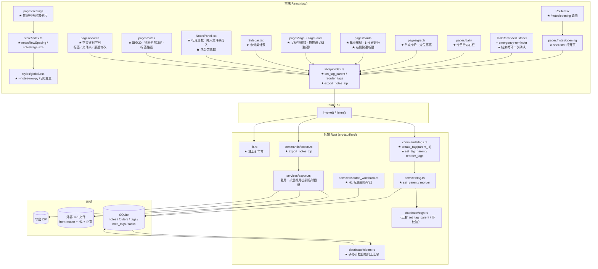
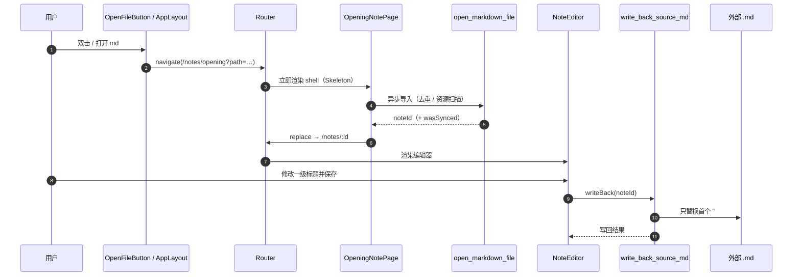
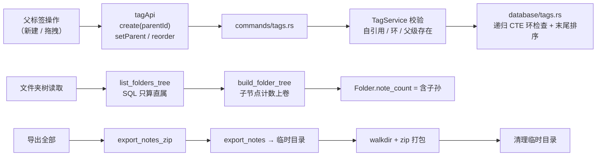

# 页面行为增强方案

> 创建：2026-11-24
> 参照：knowledge-base `66ebcae`（行距/每页 30）、`99849e4`（搜索三列）、`8aa8aac`（父标签）、`8029a99`（卡片键盘评分）、`476d8c3`（图谱节点卡片）、`f646795`/`e9ddd4c`（日记今日待办）、`d3761ea`（提醒结束循环确认）、`003e638`（拖入文件夹导入/导出全部）、`27a133e`（文件夹计数含子文件夹）、`122c831`/`2549582`（外部 md 打开/标题跟随）
> 关联：`remaining-improvements-plan.md` §2.E、`ui-v4-redesign-plan.md`（视觉换皮）

## 1. 说明

这些是**行为/交互增强**，不属于纯换皮。UI v4 换皮时一并落地可以减少重复改页面，但必须单独验收。

## 2. 清单与设计

### 2.1 笔记列表：行距三档 + 每页 30

- store：`notesRowSpacing: "compact" | "standard" | "comfortable"`，默认 `standard`；`notesPageSize` 默认 30（上限 100）。
- 面板/列表行使用同一 CSS 变量控制行高与上下留白。
- 设置页「界面」新增行距选择；分页默认值仅对未保存过偏好的用户生效。
- 文件：`src/store/index.ts`、`NotesPanel.tsx`、`pages/notes/index.tsx`、设置页。

### 2.2 搜索页空关键词三列

- 无关键词、无筛选时显示：
  - 标签（最近/全部）
  - 文件夹（树或平铺）
  - 文件（最近修改）
- 点击任一列项直接进入对应范围；选中项写入现有筛选条件。
- 文件：`src/pages/search/index.tsx`、搜索侧栏组件。

### 2.3 父标签

- `tags` 表已有 `parent_id` 能力（本仓 `database/tags.rs` 存在 `set_tag_parent` 但未暴露 UI）。
- 标签页：新建/编辑支持选择父标签；列表按层级展示；标签选择器显示路径。
- 约束：禁止环、同级重名、父标签删除时子标签上移。
- 文件：`database/tags.rs`、`components/settings/Tag*` 或标签页、`types`。

### 2.4 卡片复习：单页 + 数字键评分 + 右侧快速新建

- 去掉多 Tab，改单页布局；键盘 1–4 对应「重来/困难/良好/简单」。
- 右侧常驻快速新建卡片（正面/背面/所属笔记）。
- 文件：`src/pages/cards/index.tsx`、卡片 API、store。

### 2.5 图谱：节点卡片 + 定位

- 单击节点弹出卡片：标题、摘要、标签、所在文件夹、打开/定位按钮。
- 定位：居中并高亮，保持缩放合理范围。
- 文件：`src/pages/graph/index.tsx`、图谱组件。

### 2.6 日记：今日待办

- 日记右侧栏新增「今日待办」：显示当天到期/当天完成，可直接勾选与添加。
- 复用任务服务；失败不阻断日记编辑。
- 文件：`src/pages/daily/index.tsx`、`components/layout/panels/DailyPanel.tsx` 或右侧栏组件。

### 2.7 提醒「结束循环」二次确认

- 提醒弹窗中的「结束循环」移到左下角，点击后二次确认，避免误触终止重复任务。
- 文件：提醒弹窗组件（`components/` 下提醒相关）。

### 2.8 拖入文件夹按层级导入 + 导出全部笔记

- 拖入文件夹：扫描目录结构，按相对路径创建文件夹树并导入文件。
- 设置/笔记页新增「导出全部笔记」入口（目录或 ZIP）。
- 文件：`components/layout/panels/NotesPanel.tsx`、导入服务、导出命令。

### 2.9 文件夹计数含子文件夹

- 文件夹行尾显示「含子文件夹」的笔记数；「未分类」也显示数量。
- 复用现有统计查询，避免 N+1。
- 文件：`database/folders.rs`、侧栏。

### 2.10 外部 .md 打开与标题跟随

- 双击打开提速：先展示 shell，再异步加载；避免白屏等待。
- 修改一级标题后外部文件标题同步更新（写回时保留其余内容）。
- 文件：`services/source_file.rs`、`services/source_writeback.rs`、打开流程。

## 3. 分批与验收

| 批次 | 内容 | 验收 |
|------|------|------|
| B1 | 行距/每页 30、搜索三列、文件夹计数 | 设置重启保持；分页数据正确 |
| B2 | 父标签、卡片键盘评分、图谱节点卡片 | 标签层级正确；键盘不误触；图谱定位准确 |
| B3 | 日记今日待办、提醒二次确认 | 待办与任务页一致；误触不再终止循环 |
| B4 | 拖入文件夹、导出全部、外部 md | 目录层级正确；导出完整；标题跟随 |

**通用门禁**：`cargo test --lib`（涉及 DAO 时）、`pnpm test`、`tsc`、`build`。

## 4. 风险

| 风险 | 应对 |
|------|------|
| 父标签引入环 | 服务层校验 + 单测 |
| 键盘评分与输入框冲突 | 仅在复习焦点区监听；输入框内禁用 |
| 拖入大目录阻塞 UI | 扫描异步 + 进度事件；分批入库 |
| 外部 md 写回覆盖 | 只改标题行；保留 front-matter 与正文 |

## 5. 改动架构图（实施后）

> 2026-11-24：B1–B4 全部落地。图中 `★` 为本次新增/修改点。

### 5.1 总体分层架构

### 5.2 外部 .md 打开与写回时序（B4）

### 5.3 关键数据流

